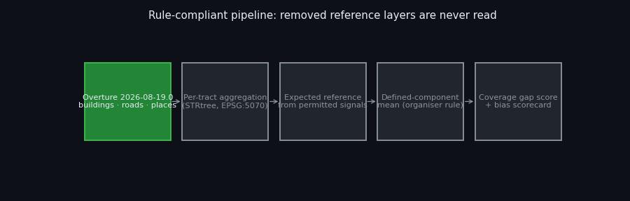
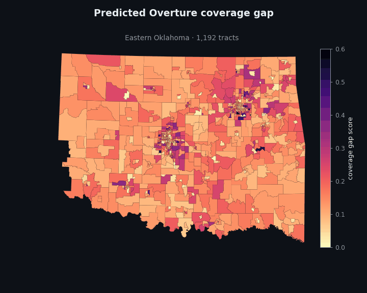
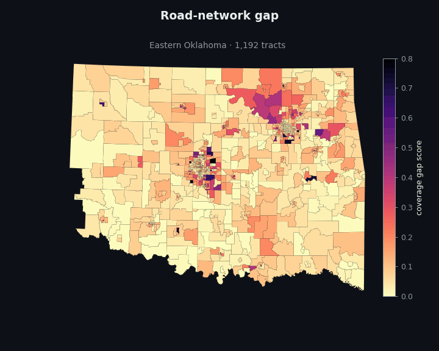
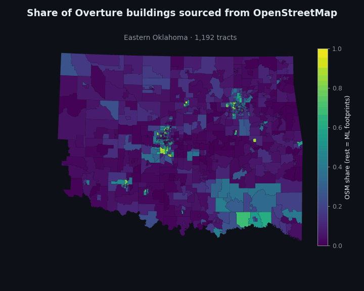
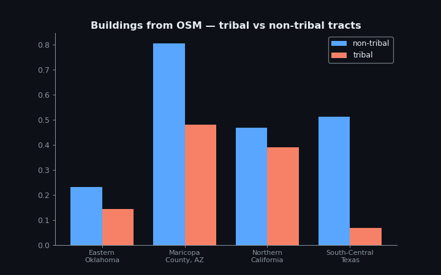

# Overture Coverage-Gap Equity: Who Is Missing from the Map?

**A rule-compliant, fully reproducible estimator of Overture Maps coverage gaps across 9,379 U.S. Census tracts, plus a bias discovery on *where Overture's buildings come from*. Built for the [Zindi × Humane Intelligence Bias Bounty Mapping Equity Challenge](https://zindi.world/competitions/bias-bounty-mapping-equity-challenge).**



| | |
|---|---|
| **Task** | Estimate the organiser coverage-gap score (0 = fully mapped, 1 = absent) per tract in four climate-exposed regions |
| **Metric** | RMSE vs hidden organiser scores, plus an automatic equity *Bias Scorecard* |
| **Data used** | Only the current challenge package: Overture `2026-08-19.0` extracts, ACS B25001 housing units, strata tables |
| **Data never used** | TIGER roads, Microsoft footprints, HIFLD/USGS facilities, CBP (removed by the organisers on 2026-09-25), and any copy of them |
| **Runtime** | ≈ 1 h of feature extraction streamed straight from the public bucket, then < 10 s to score |
| **Determinism** | No randomness; reruns produce byte-identical CSVs (SHA-256 logged in [`experiments/LOG.md`](experiments/LOG.md)) |

---

## Official upload status — 28 October

The account is registered and joined. Upload **G4i5SJRG** (`E001_prior.csv`)
was rejected during processing with missing IDs including `53001950100`,
`53001950200`, `53001950301`, `53001950302` and `53001950303`.
**There is no RMSE or accepted scored entry yet.** A first-submission badge
does not establish successful scoring.

The regional package contains9,379 IDs, matching the Info-page tract counts;
the reported missing IDs are not in that union. The current Zindi template
must be reconciled before any candidate upload. Support has been asked for
the authoritative ID list. We do not fabricate predictions for unknown tracts
or retry identical files. The new upload gate requires exact ID-set equality:

```sh
python src/validate_submission.py --submission submissions/E001_prior.csv --sample /path/to/current/SampleSubmission.csv
```

## Three isolated candidates prepared for evaluation

[`src/prepare_interventions.py`](src/prepare_interventions.py) now generates the
control and three prespecified candidates directly from the permitted cached
features and strata. Each CSV has **9,379 unique tract IDs**, finite scores in
[0,1], and a recorded SHA-256. The regenerated E001 control is byte-identical
to the existing submission file.

| Candidate | Single change from E001 | Tracts whose prediction changes | Status |
|---|---|---:|---|
| E003 | Building base gap0.02→0.05 | 9,377 | Prepared; official RMSE unknown |
| E004 | Road tertiary-class leakage0.15→0.30 | 8,830 | Prepared; official RMSE unknown |
| E005 | Building base gap0.02→0 | 9,377 | Prepared; official RMSE unknown |

These test uncertainty in the Overture-only expectations; **they are not claimed
improvements**. No organiser target was reconstructed. An additional diagnostic
found zero tracts with no Overture buildings but positive ACS housing, so its
no-change candidate is discarded rather than spending a submission on an
identical CSV. ACS is not substituted for the building-count denominator.

```sh
python src/prepare_interventions.py --data data
```

[Candidate files and input hashes](submissions/interventions/manifest.json)
are committed with the generator. There are no public target labels, so only
an accepted official submission can assess RMSE. Check E001 first, preserve
all scores and compare each isolated change against it; do not upload duplicates.
The current public rules allow10 submissions/day and300 total; the submission
page displays a200-total counter, so quota must be checked before upload.
All three candidates remain unscored while the ID contract is unresolved.

## 1. Highlights

- **Clean by construction.** The organiser target is defined against reference layers that were later withdrawn. Our pipeline never reads them, and we deliberately discarded an earlier baseline that had been built on them (decision E000 in the log). Every number on this page comes from data that a judge can download today.
- **Organiser rule, permitted inputs.** We keep the exact scoring grammar: three components, each a capped ratio, combined as the mean of the components that are *defined* for a tract. Each withdrawn denominator is replaced by an expectation built from Overture-internal structure, ACS housing and the strata spine.
- **A bias the scorecard cannot see: provenance.** In Eastern Oklahoma, **82 % of Overture buildings in tribal tracts are machine-learned footprints, and only 14 % come from OpenStreetMap.** In non-tribal tracts of the same region the ML share is 35 %. ML footprints carry no names, addresses or building use, which matters when a dispatcher needs to find a specific structure.
- **244 flagged tracts, 823,716 residents.** These have more than 1,000 residents, more than 50 km², **no fire-station POI recorded in Overture**, and **at least 95% of their Overture building records sourced from Microsoft ML footprints**. Of these, 67 are tribal tracts in Eastern Oklahoma (203,784 residents). Missing Overture station data does *not* establish absence of physical fire stations.



## 2. Method

### 2.1 Features per tract (only permitted layers): [`src/features.py`](src/features.py)

| Layer | Feature | How |
|---|---|---|
| Overture buildings | count, and counts by upstream `sources[0].dataset` (OSM / Microsoft ML / Esri), share with height | bbox centre → tract via STRtree `within` |
| Overture roads | km by class (`motorway`, `trunk`, `primary`, `secondary`, `tertiary`, …) | clipped to the tract, length in EPSG:5070 |
| Overture places | total, high-confidence, `fire_department`, `ambulance_and_ems_services`, school categories, `hospital` | point-in-tract |
| Overture infrastructure | transit / airport features | point-in-tract |
| ACS B25001 | housing units, tract polygon, land area (EPSG:5070) | as shipped |
| Strata | population, % urban, RUCA, SVI, CVI, tribal overlap | join on `GEOID` (text, so leading zeros are kept) |

The lon/lat axis-order trap the organisers warn about is avoided: coordinates are read as `OGC:CRS84` and reprojected with GeoPandas.

### 2.2 Score model: [`src/model.py`](src/model.py)

| Component | Organiser definition | Permitted expectation used here |
|---|---|---|
| Road network | 1 − min(1, Overture named-highway km / TIGER S1100+S1200 km) | TIGER-named km ≈ Overture named km + λ · Overture tertiary km (class-boundary leakage). Undefined where Overture has no named highway. |
| Buildings | 1 − min(1, Overture count / Microsoft count) | Overture already conflates Microsoft ML footprints, so a small base gap, plus a penalty where the stock is OSM-only and ML rows were deduplicated away |
| POI, establishments half | 1 − min(1, Overture places / CBP establishments) | expected establishments = κ · housing units · (1 + β · %urban) |
| POI, facilities half | mean over fire / EMS / schools of 1 − min(1, Overture / reference) | Poisson probability that the reference holds a facility, from land area and population; gap when Overture lists none |
| Composite | mean of **defined** components | same rule |

Edge cases follow the organiser convention: an undefined component is written as `0` in its column and left out of the mean. Zero-population and water-dominated tracts fall back to the components that remain defined. No tract is left blank.



### 2.3 Validation protocol

The challenge provides **no labels**. Any offline validation against a reconstructed target would require the withdrawn layers, so it is ruled out. The only legitimate validator is the official public leaderboard (≈ 30 % of tracts). We therefore run it as a controlled experiment series:

*hypothesis → one change against the best previous file (the control) → one whole-file submission → accept or reject*.

Global parameters only: no per-tract or per-subset probing. Every run, negative results included, is logged in [`experiments/LOG.md`](experiments/LOG.md) and [`experiments/experiments.csv`](experiments/experiments.csv).

## 3. Results

Results are recorded in [`experiments/experiments.csv`](experiments/experiments.csv) as they come back from the leaderboard. The selected final submissions are marked there.

## 4. Bias discovery: provenance inequality in Overture buildings



**Pattern.** The automated scorecard measures *how much* is mapped. It never asks *what kind* of record fills the map. Overture merges OpenStreetMap buildings (human-mapped, often with names, addresses and building use) with machine-learned footprints (geometry only). The mix is far from uniform:

| Region | Tribal: OSM share | Tribal: ML share | Non-tribal: OSM share | Non-tribal: ML share |
|---|---|---|---|---|
| Eastern Oklahoma (805 / 387 tracts) | **14.3 %** | **82.0 %** | 23.1 % | 35.2 % |
| Maricopa, AZ (37 / 1,556) | 48.0 % | 44.5 % | 80.5 % | 13.5 % |
| Northern California (15 / 576) | 38.9 % | 58.4 % | 46.9 % | 50.6 % |

The same gradient appears along the rural/urban axis. In rural Eastern Oklahoma, 86 % of buildings are ML footprints and fire stations are listed at 2.5 per 1,000 km² (urban: 17.2).



**Why it matters.** A count-based score treats an ML polygon and a fully attributed OSM building as equal, so these tracts can look *well covered*. Yet emergency dispatch and evacuation routing need addressable, named, typed structures. The 244 strictly flagged tracts are listed with population, area and the verified ML-source share in [`results/discovery_flagged_tracts.csv`](results/discovery_flagged_tracts.csv), and stratum tables are in `results/discovery_provenance_by_*.csv`. Everything reproduces from the challenge package with `python src/discovery.py`.

## 5. Reproduce

```bash
python -m venv .venv && .venv/bin/pip install -r requirements.txt   # Windows: .venv\Scripts\pip
python src/features.py eastern-ok maricopa-az northern-ca south-central-tx   # streams from the public bucket
python src/model.py experiments/params_best.json submissions/final.csv
python src/discovery.py
python src/figures.py
```

No credentials, paid APIs, AutoML or LLM calls are needed at run time.

## 6. Limitations

As in any no-label setting, the component expectations are calibrated with a small number of whole-file leaderboard scores, so they reflect the public 30 % split. The Texas tribal stratum is a single tract and is not interpreted. Overture's `sources` field records the first contributing dataset only. The earlier low-OSM proxy flagged 276 tracts (955,406 residents), but 32 had less than 95% ML provenance; those 32 are excluded from the corrected strict ML definition. This source-provenance association does not by itself demonstrate failed emergency dispatch or a missing real-world fire station.

## 7. Credits and licence

- Data: [Humane Intelligence / Source Cooperative challenge package](https://source.coop/humane-intelligence/bias-bounty-mapping-equity-challenge) (CC-BY-SA 4.0), Overture Maps Foundation (ODbL / CDLA), U.S. Census Bureau ACS, CDC SVI, USDA RUCA and the other strata sources listed in the package README.
- Challenge: Zindi, Humane Intelligence, Radiant Earth, Heising-Simons Foundation.
- Tooling: DuckDB, GeoPandas, Shapely, pandas, Matplotlib, imageio.
- Code: MIT © 2026 Francisco Angulo de Lafuente ([@Agnuxo1](https://github.com/Agnuxo1)).
